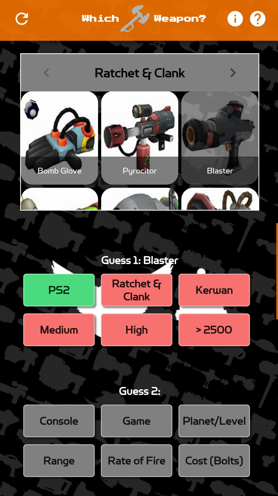
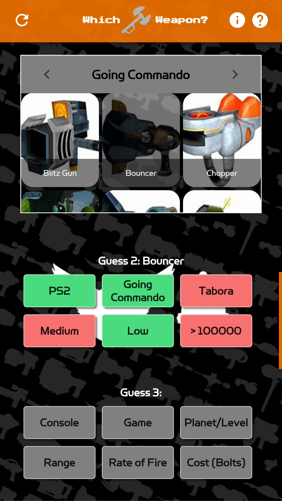
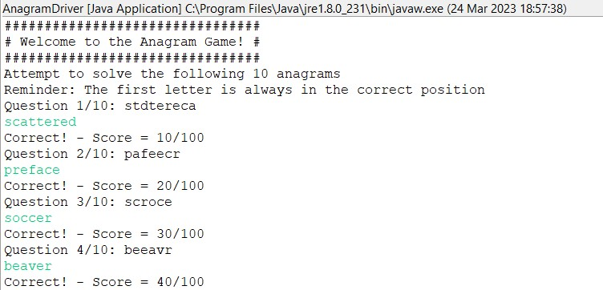

# assortedprojects

## A.I.
Includes two projects:-
  - OpenAI Image Generator (ReactJS + OpenAI, moved from 'Other Projects: Javascript' directory, screenshot below)
  - (NEW 12/03/2026) Copilot Coasters. A ReactJS blog-style web app about rollercoasters in Blackpool Pleasure Beach Resort, boilerplated using GitHub Copilot

 

## Which Weapon?
Inspired by games like 'Wordle' & 'Who Are Ya?', this is a guessing game based around my favourite video game franchise, Insomniac's 'Ratchet & Clank' series and the weapons you can unlock in them. Includes both a (less refined & older) Java version and a ReactJS version which is playable on mobile & desktop. Screenshots of an example partial playthrough on mobile shown below:-

  
  

### UPDATE (22/11/2026):-
  - Guess input method changed from typing into autocomplete box to clicking image in the ImageList display, to differentiate game further from Wordle & similar games, images greyed out & disabled as buttons after selection
  - Single ImageList changed to separate lists for each game in the franchise, lists navigated through by selecting pagination left & right arrows in ImageList header, with text in header changed to currently viewed game
  - ImageList display on browser changed to horizontally scrollable list at the top of the page
  - On mobile, top half of page is fixed and bottom half is scrollable to keep ImageList fully in view for whole playthrough on mobile, bottom half also scrolls to next guess automatically after each guess submitted
  - Header changed to darker orange for better contrast to white text, disclaimer (i.e. stating game names, weapon names etc. are property of Insomniac, game inspired by Wordle etc.) added to header via info icon
  - Fixed, darker background images for both mobile & browser to remove occasional colour clashes caused by previous changing background functionality

## Other Projects: Javascript
Includes three projects:-
  - A breakout game (vanillaJS)
  - Mock premier league transfer data display (ReactJS)
  - UK Rollercoaster data web scraper, data scraped from rcdb.com (NodeJS & Cheerio + ReactJS)

## Other Projects: Java
Includes three Java programs: an anagram guessing game, hangman, and a tic-tac-toe game made with swing package GUIs. A screenshot of a (partial) example playthrough of the anagram game is shown below:-

  

## Codility & Hackajob Practice Exercises
Small programs, solutions to an assortment of programming practice exercises found on the Codility & Hackajob platforms. All of these were done in Java.
